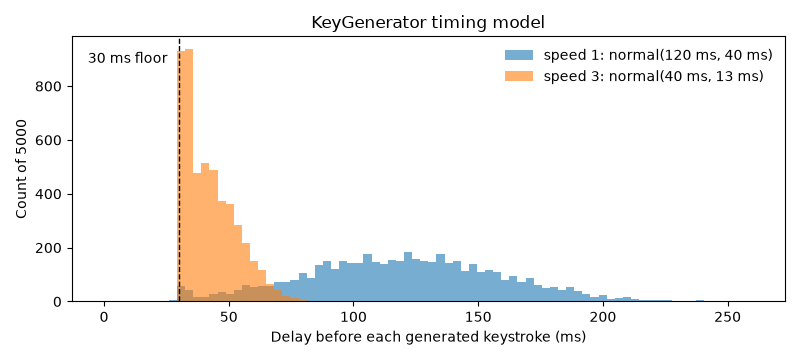

# KeyMaster: implementation

## Requirements

- Python 3.11+ and [uv](https://docs.astral.sh/uv/) (CI uses uv 0.13.7).
- On Linux, pynput needs an X server (prefix commands with `xvfb-run -a` if you have no display), and its
  `evdev` dependency builds from source, so a system Python needs its headers (`python3-dev`). uv's
  managed Python already has them (`uv sync --managed-python --all-extras`).
- On macOS, typing and recording ask for Accessibility permission for your terminal (and Input Monitoring
  for `-l`), per pynput's docs.
- No network.

## Usage

### Demo

`scripts/demo.py` runs the whole pipeline on keystrokes made up for the purpose. It plays a fixed
script of key events (including a Shift, a typo and a long pause) through the real recorder with a
fake clock, then generates the same pangram at two speeds. It types nothing, listens to nothing and
writes nothing.

```bash
uv run python -m scripts.demo
```

```text
1. Recorded (scripted events through KeyLogger):
   typed 'Hi there!'
   saved as {"id": "A000", "string": "Hi there!", "keystrokes": [["'H'", null], ["'i'", 0.14], ["Key.space", 0.11], ["'t'", 0.19], ["'h'", 0.12], ["'r'", 0.09], ["Key.backspace", 0.31], ["'e'", 0.16], ["'r'", 0.13], ["'e'", 0.1], ["'!'", 3.0051]]}
   11 keystrokes, 80.0 WPM, mean 0.15 s, std 0.0675 s (the 3.0051 s pause is left out)
2. Generated from a string (nothing typed):
   speed 1: 44 keystrokes, 114.1 WPM, mean 0.1052 s, std 0.036 s
   speed 3: 44 keystrokes, 284.4 WPM, mean 0.0422 s, std 0.0121 s
```

`uv run python -m scripts.demo --chart docs/timing.png` redraws the chart below from 5,000 seeded
draws of the timing model at each speed:



`tests/test_design.py` checks that the demo still prints exactly the block above, read from this file.

### CLI

```bash
uv run python -m scripts.cli -d -n -s "hello world"   # dry run: types nothing, logs nothing
uv run python -m scripts.cli --stats                  # "No recorded keystrokes yet" on a fresh clone
```

`uv run python -m scripts.cli [flags]`. With no script flag it types `-s STRING` into the focused
window after the initial lag.

| Flag | Effect |
| --- | --- |
| `-s STRING`, `--string` | Text to type. |
| `-c`, `--clipboard` | Type the clipboard instead (needs the `clipboard` extra, pyperclip). |
| `-l`, `--listen` | Record your typing for up to 30 s or 50 words; Esc or `*` stops. Then replays it unless `-d`. |
| `--stats` | Print log count, keystrokes, WPM and delays for `logs/keystrokes.json`, then exit. |
| `-d`, `--disable` | Don't type anything. |
| `-n`, `--no-log` | Don't append to the log files. |
| `-il SECONDS`, `--initial-lag` | Wait before typing; 0 to 30, default 3. |
| `-nn`, `--no-newlines` | Skip newlines when typing. |
| `-nu`, `--no-unicode` | Skip non-ASCII characters. |

Exit codes: `0` on success; `1` with a `ValueError` traceback for an `--initial-lag` outside 0-30.

Recorded runs are appended to `logs/keystrokes.json` and typed runs to
`logs/simulated-keystrokes.json`, both under the checkout. `logs/` is created on the first save and
is git-ignored.

### Python

```python
from client.analyze import Analyze
from client.generate import Generate
from client.configurate import Config

ks = Generate(Config(disable=True)).simulate_string("The quick brown fox")  # types nothing
print(Analyze(Config(logging=False)).get_stats(ks))
# {'keystroke_count': 19, 'average_delay': 0.0423, ...}; delays are random

Analyze().visualize()             # bar chart of average delay per key, from logs/keystrokes.json
Analyze().visualize(mode="box")   # box plot of all delays
```

`classes/` holds the engines (`KeyLogger`, `KeyGenerator`, `KeyParser`) and `client/` the wrappers
above, which share one `Config`.

## How it works

A keystroke is a key plus the delay before it, and that one model is shared by the recorder, the
generator, the analyzer and the JSON logs.

```text
 your typing ──► KeyLogger ──┐                     ┌──► KeyParser: WPM, delays, charts
                             ├─► KeystrokeList ────┤
 a string ───► KeyGenerator ─┘   (key, delay)…     ├──► KeyGenerator: types it out
                                                   └──► logs/*.json (only if it rebuilds the text)
```

**One keystroke model.** `Keystroke(key, time)` in `utils/validation.py` stores the key as pynput
prints it (`"'a'"`, `"Key.space"`, `"Key.backspace"`) and `time` as seconds since the previous key;
the first key has `None`. A `KeystrokeList` replays its keys into the text they produce, so
backspaces, tabs and newlines count, and Shift and Caps Lock don't add text. Both the recorder and
the generator produce this type, so a recording can be typed back and a generated list can be
analyzed the same way.

**Logs must rebuild their text.** A log is `{"id", "string", "keystrokes"}`, where each keystroke is
the JSON pair `[key, time]` (`KeystrokeEncoder` and `KeystrokeDecoder`). It is saved only if
replaying the keystrokes gives back `string`, so a log never disagrees with itself. The JSON is
compact and readable by any tool.

**Timing is a deliberately simple model.** Each generated delay is drawn from a normal distribution
with a mean of 120 ms and a standard deviation of 40 ms, both divided by the speed multiplier
(default 3, capped at 10). A draw under 30 ms becomes 30 ms plus a tenth of the draw, so keys never
land on top of each other. The author's own typing was close to speed 1. Upstream issues
[#6](https://github.com/TanGentleman/KeyMaster/issues/6) and
[#56](https://github.com/TanGentleman/KeyMaster/issues/56) note that these constants are
hand-picked and propose fitting them to a typing dataset or to a target WPM.

**Typing divides by speed again.** `simulate_keystrokes` sleeps each `time / speed`, and a delay
over 3 s becomes 3 s plus a thousandth of it. A generated list is already scaled by the speed it
was made at, so at the default speed 3 it types about 9 times faster than speed 1. A recording
replayed at speed 1 keeps its original rhythm.

**Shift.** `pynput`'s `tap()` presses Shift by itself, so recordings drop the Shift key and fold
its delay into the next character. That matches what text you saw. The generator can instead insert
an explicit Shift before a capital or a shifted symbol, with one Shift covering a run like `AB` or
`##` (`GENERATE_SHIFTS` in `utils/settings.py`, off by default). When typed, these Shift keys only
add their delay.

**Stopping.** Recording ends on Esc, on `*` (logged as the code `STOP`), after 50 words or after 30
s. Generation stops at `*`, after 300 words or after a duration limit. Every recording and typing
run has a limit, so a run you forgot about stops by itself.

**Keys that are never typed.** Banned keys (`√` by default) are dropped when recording and
skipped when typing. Newlines and non-ASCII characters can be filtered out with `-nn` and `-nu`.
Keys with no text and no special meaning, like arrows or Cmd, are not recorded.

**Analysis.** `KeyParser` computes WPM as characters per minute divided by 5 (a "word" is 5
characters). It leaves delays over 3 s out of the mean and standard deviation, because a pause to
think is not typing speed. The recorder already caps such pauses at 3 s plus a trace, as in the
demo, so they stay visible in the log. `visualize()` draws the average delay per key as a bar chart,
and `visualize(mode="box")` draws a box plot of all delays.

`tests/test_design.py` pins this behaviour. Built from October 2023 to April 2024 in 159 commits; `CHANGELOG.md` traces how the keystroke
model, the codec, the Shift handling and the client API took shape.

## Tests

```bash
sudo apt-get update && sudo apt-get install -y xvfb
uv sync --locked --all-extras
xvfb-run -a uv run pytest
```

CI (`.github/workflows/ci.yml`) runs these on Python 3.11 and 3.14. With a display, `uv run pytest` is
enough. The tests fake the keyboard controller, the clock, the clipboard and `plt.show`, so they never
type, listen or open a window.

## Limits

- Typing and recording act on whatever window has focus.
- Never verified on a real desktop: live recording (`-l`) and typing into another window. Under
  Xvfb the pynput listener never returns, so only the faked paths are tested.
- Logs hold everything you typed while recording, in plain JSON. The demo and tests use only
  made-up keystrokes.
